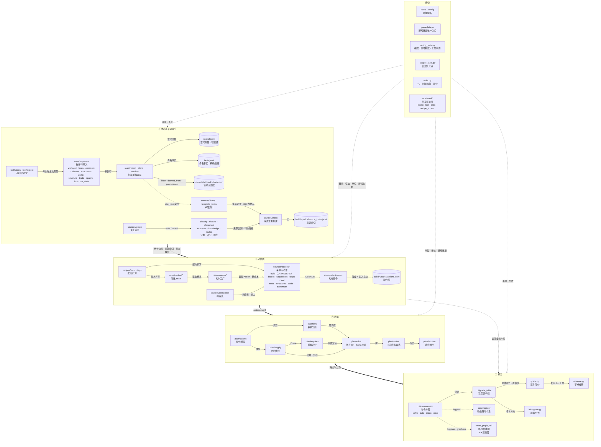

# 架构

五个阶段，每个阶段只消费前一个阶段的产物，不直接调用前一阶段的代码。

## 总图

## 读图规则

- 子图内部只画本阶段模块之间的关系，跨阶段一律用子图间箭头。
- 粗箭头是阶段推进，虚线是旁路读取或横切依赖。
- 阶段②有两条平行链：
  - 统计行：`loot/expect` 算每次触发的期望，`stats/importers` 产出统计行，`stats/model` 校验行形状，`store` 落成三个文件。
  - 来源索引：`sources/graph` 给出 `Rule` / `Graph`，`classify`、`closure`、`placement` 建立在它之上，`exposure` 与 `knowledge` 合成 `routes`，`drops` 与 `template_items` 提供掉落索引，三者汇入 `sources/index`。
- 阶段③的入口依赖阶段②的两份产物：`case/context` 读统计快照，`actions/build` 读来源记录，`recipes/facts` 与 `tags` 提供配方折算。
- 阶段③内部：`case/context` 到 `case/sources` 再到 `actions/build`；`gamedata` 提供标定值，`sources/constructs` 的能力成本也取自它。
- 阶段③对④只有类型依赖（`Action` / `Requirement`），没有运行期数据依赖。
- 阶段④内部：`plan/actions` 是底层类型，`tiers`、`supply`、`requires` 建立在它之上，`solve` 汇总三者。
- 阶段⑤：`grade` 与 `observe` 读 `actions.jsonl`，对目标取子图后调 `plan/solve`；`bg plan` 是唯一现场拼图的命令，走 `case/registry.builder_for()`。
- 跨阶段的节点级依赖不画箭头。图上只保留三条主干（②到③、③到④、④到⑤）与③到⑤的读盘旁路；其余关系见各阶段的文字说明：②到⑤是 `bg stat` 的回退查询与 `bg plan` 的现场拼图，④到⑤是子图求解。
- 横切层不产出阶段产物：`paths` 提供目录，`mcshared` 还原语法，`units` 给 TU 与评分，`gamedata` 是游戏数据的唯一入口。

## 产物与命令

表中命令都要显式给地形包版本（`--pack-version` / `--pack` / `--label`）；`26.3` 只是示例。

| 产物 | 写入命令 | 输入 |
|---|---|---|
| `data/upstream/<pack>/` | `bg data sync` | 两个上游仓库 |
| `data/upstream/<pack>/` 校验 | `bg data verify` | manifest |
| `data/stats/<pack>/{meta,spatial,facts}` | `bg data ingest` | 采集侧运行目录 + 上游 facts |
| `facts.jsonl` 的 `loot_expectation` | `bg data loot` | 数据包战利品表 + `template.jsonl` |
| `build/<pack>/source_index.jsonl` | `bg index sources` | `graph.json` + 统计 + 知识表 |
| `build/<pack>/slots.jsonl` | `bg index slots` | 来源索引 + 配方 IR |
| `build/<pack>/actions.jsonl` | `bg index actions` | 来源索引 + 统计 + 配方事实 |
| 难度表与直方图 | `bg grade` | 落盘动作图 |
| 路线合成图（DOT/SVG/HTML） | `bg plan --graph-out` | 现场拼图的动作集 |

合成图默认走 `route_graph_ra`：图结构与渲染层照搬 RecipeAnalysis 的 `PathGraph` / `build_dot`（item 矩形、rule 菱形），本仓库只提供 `PathTree → PathGraph` 的 adapter 与 HTML 外壳（路线对照表）。旧的单层节点渲染器 `route_graph.py` 与 `--graph-legacy` 已于 2026-11-25 删除。

`data/upstream/`、`data/stats/` 与 `build/` 都不入库：前者由 `bg data sync` 重建，中者由 `bg data ingest` 与 `bg data loot` 重建，后者是运行产物。

## 分层边界

- 成本公式只在 `case/sources/` 与 `plan/`；`stats/` 只存事实，`sources/` 只翻译，`plan/` 只择优且不做 IO。
- 新增 stat_type 必须归入 `SPATIAL_TYPES` 或 `FACT_TYPES`，`stats/model.py` 末尾有断言；`resolver` 只服务前者。
- 未接通的数据必须记账，不能静默丢弃：动作层记 `uncovered`，构建层记 `missing_prereqs` 与 `no_action_items`，导入层记 `gaps`。
- 改动后的重跑顺序：`stats/`、`bg data loot`、`bg index sources`、`bg index actions`。只改知识表注释也要重跑 `bg index actions`，输入指纹覆盖它。
